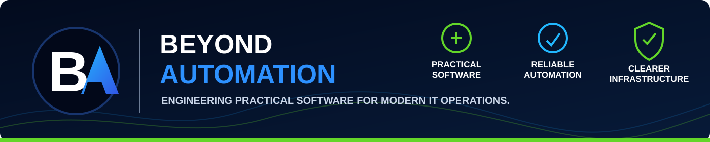

 

[**Website**](https://beyondautomation.io) &nbsp;·&nbsp; [**OffboardPilot**](https://github.com/Beyond-Automation/OffboardPilot) &nbsp;·&nbsp; [**Download AIHAT**](https://beyondautomation.io/aihat) &nbsp;·&nbsp; [**LinkedIn**](https://www.linkedin.com/company/beyond-automation-io) &nbsp;·&nbsp; [**YouTube**](https://www.youtube.com/@BeyondAutomationIT)

## What We Build

Beyond Automation builds lightweight tools for practical IT infrastructure problems and is opening its projects for the community to learn from and improve together.

Our work grows out of hands-on experience with Windows infrastructure, Active Directory, Microsoft 365, and everyday IT operations. We value accessible tools, straightforward documentation, and respectful collaboration. Whether you are reporting your first bug or contributing years of engineering experience, you are welcome here.

OffboardPilot is our first project moving to open source. Each published project will have its own source, license, documentation, releases, and contribution guidance.

| Product | Purpose | Status |
| --- | --- | --- |
| [**OffboardPilot**](https://github.com/Beyond-Automation/OffboardPilot) | Repeatable user offboarding across Active Directory and Microsoft 365 | **Open Source** |
| [**AIHAT**](https://github.com/Beyond-Automation/AIHAT-Releases) | Windows infrastructure health assessment and reporting | **v1.2.0 -- Free Download** |
| **PatchPilot** | Windows patch readiness and update-health assessment | **In Development** |
| **NetFixLab** | Practical network troubleshooting and diagnostics | **In Development** |

### OffboardPilot -- Hybrid AD + M365 Offboarding Automation

OffboardPilot automates the full employee offboarding pipeline across on-premises Active Directory and Microsoft 365 in six steps, with a reconciliation report and audit trail on every run.

**[View source and documentation](https://github.com/Beyond-Automation/OffboardPilot)**

- Disables AD account and blocks Entra ID sign-in
- Revokes all active M365 sessions and OAuth tokens
- Converts mailbox to Shared, configures forwarding, removes licenses
- Removes Exchange Online and AD distribution group memberships
- Handles AD-only users with no Exchange Online mailbox
- Full color-coded reconciliation report and transcript per run

### AIHAT -- Infrastructure Health Audit Toolkit

AIHAT evaluates Windows system health, Windows Update, security, and networking while producing clear findings and local reporting.

**[Download the signed AIHAT v1.2.0 installer](https://github.com/Beyond-Automation/AIHAT-Releases/releases/tag/v1.2.0)**

- Free public Windows tool
- Digitally signed and timestamped
- Windows verified publisher: **Randall Lewis**
- Read-only assessment
- No account, telemetry, or audit-result upload
- Published SHA-256 checksum

---

## Contributing

Contributions can start with trying a tool in your lab, reporting a reproducible bug, improving a confusing instruction, suggesting a practical use case, or submitting code.

Start with the project README and contribution guide. Share what you tried, what you expected, and what happened. We welcome questions and ask everyone to treat contributors with patience and respect.

- [OffboardPilot contribution guide](https://github.com/Beyond-Automation/OffboardPilot/blob/main/CONTRIBUTING.md)
- [OffboardPilot issues](https://github.com/Beyond-Automation/OffboardPilot/issues)

---

## Engineering Standard

- Security-conscious design and least-privilege access
- Version-controlled development and pull-request workflows
- Protected branches and automated quality gates
- Dependency, secret, and vulnerability scanning
- Clear installation and release instructions
- Real-world lab testing and reproducible examples
- Signed, checksummed public releases
- Maintainable architecture and documented support boundaries
- Practical documentation and constructive code review

### Build useful tools. Share what we learn.

---

## Trust and Security

Official public releases are distributed only through repositories owned by the **Beyond-Automation** organization and through [beyondautomation.io](https://beyondautomation.io).

- [OffboardPilot releases](https://github.com/Beyond-Automation/OffboardPilot/releases)
- [AIHAT releases and documentation](https://github.com/Beyond-Automation/AIHAT-Releases)
- [Organization security policy](https://github.com/Beyond-Automation/.github/blob/main/SECURITY.md)
- [Beyond Automation contact](mailto:randall@beyondautomation.io)

Do not download Beyond Automation software from third-party mirrors. Security vulnerabilities should not be posted in public issues -- use the Security tab in the affected repository.

---

## Focus Areas

`Windows Infrastructure` &nbsp;·&nbsp; `Active Directory` &nbsp;·&nbsp; `Microsoft 365` &nbsp;·&nbsp; `PowerShell Automation` &nbsp;·&nbsp; `Lifecycle Automation` &nbsp;·&nbsp; `Infrastructure Diagnostics` &nbsp;·&nbsp; `IT Operations` &nbsp;·&nbsp; `Open Source Tools`

---

**Beyond Automation**
[Website](https://beyondautomation.io) &nbsp;·&nbsp; [YouTube](https://www.youtube.com/@BeyondAutomationIT) &nbsp;·&nbsp; [LinkedIn](https://www.linkedin.com/company/beyond-automation-io)

&copy; 2026 Beyond Automation. See each project's license for usage rights.

